<!-- ════════════════════════════  HERO  ════════════════════════════ -->

  

  

<!-- ────────────────────────────  BUTTONS  ──────────────────────────── -->

  
  &nbsp;
  
  &nbsp;
  

<!-- ════════════════════════════  ÜBER MICH  ════════════════════════════ -->
<h2 align="center">🌸 &nbsp;Über mich</h2>

<table align="center" border="0" cellpadding="0" cellspacing="0">
  <tr>
    <td width="96" valign="middle"></td>
    <td valign="middle">
      <table border="0" cellpadding="6">
        <tr>
          <td>👋 &nbsp;<b>Name</b></td>
          <td>Joshua</td>
        </tr>
        <tr>
          <td>📍 &nbsp;<b>Standort</b></td>
          <td>Saarland, Deutschland</td>
        </tr>
        <tr>
          <td>🧑‍💻 &nbsp;<b>Rolle</b></td>
          <td>Solo Developer</td>
        </tr>
        <tr>
          <td>🎯 &nbsp;<b>Fokus</b></td>
          <td>
            
            
            
          </td>
        </tr>
        <tr>
          <td>💬 &nbsp;<b>Sprachen</b></td>
          <td>
            
            
            
            
          </td>
        </tr>
      </table>
    </td>
    <td width="96" valign="middle"></td>
  </tr>
</table>

<!-- ════════════════════════════  WAS ICH BAUE  ════════════════════════════ -->
<h2 align="center">🏮 &nbsp;Was ich baue</h2>

<table align="center">
  <tr>
    <td width="33%" valign="top" align="center">
      <h3>🚗 FiveM Scripts</h3>
      Performante, saubere Resources für Roleplay-Server — von Jobs über UIs bis hin zu Custom Props &amp; Maps.
    </td>
    <td width="33%" valign="top" align="center">
      <h3>🌐 Websites</h3>
      Moderne Web-Plattformen mit Dashboards, Auth &amp; Ticket-Systemen — selbstgehostet auf eigenen Servern.
    </td>
    <td width="33%" valign="top" align="center">
      <h3>🤖 Discord Bots</h3>
      discord.py Bots mit Cog-Struktur: Tickets, Bewerbungen, Verify, Welcome, Rollen-Management &amp; mehr.
    </td>
  </tr>
</table>

<!-- ════════════════════════════  TECH STACK  ════════════════════════════ -->
<h2 align="center">⚡ &nbsp;Tech Stack</h2>

   
   
  

<!-- ════════════════════════════  STATS  ════════════════════════════ -->
<h2 align="center">📊 &nbsp;GitHub Stats</h2>

  
  

  

<!-- ════════════════════════════  KONTAKT  ════════════════════════════ -->
<h2 align="center">📮 &nbsp;Kontakt &amp; Aufträge</h2>

  Du brauchst ein Script, eine Website oder einen Bot? Schreib mir einfach! 🌸  
  

<!-- ════════════════════════════  FOOTER  ════════════════════════════ -->

  

